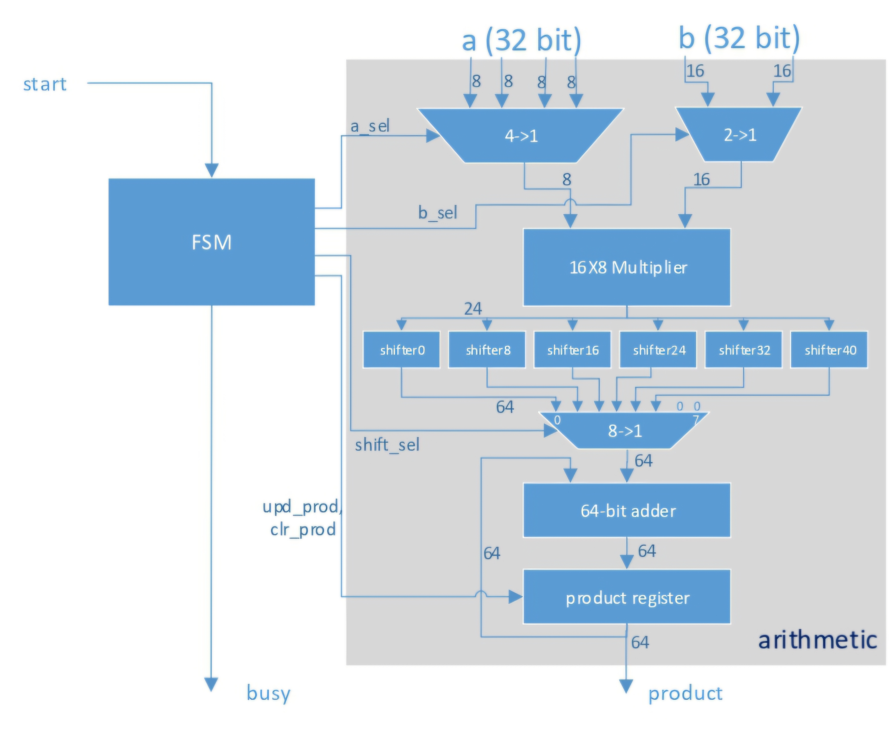
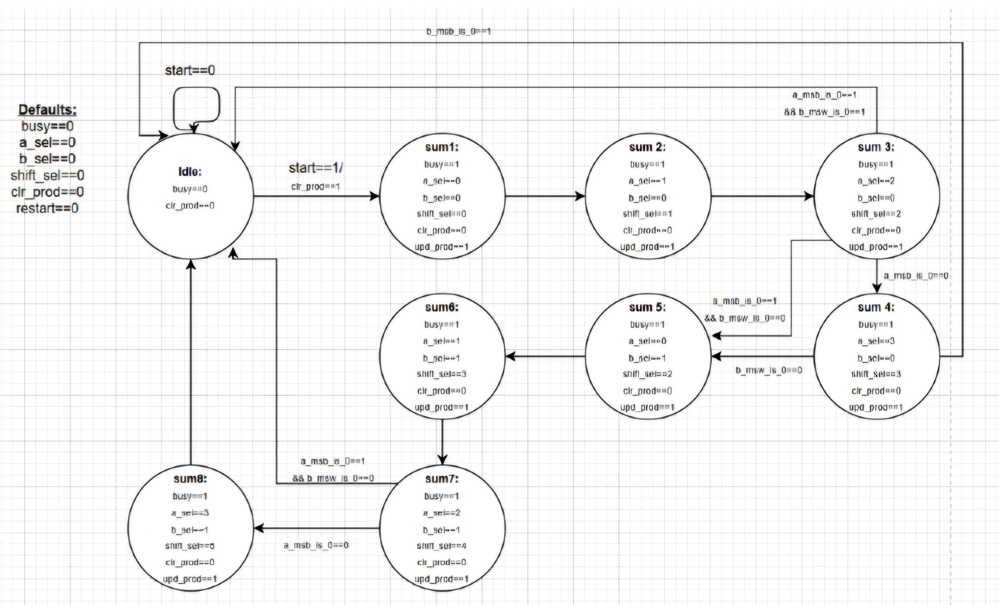
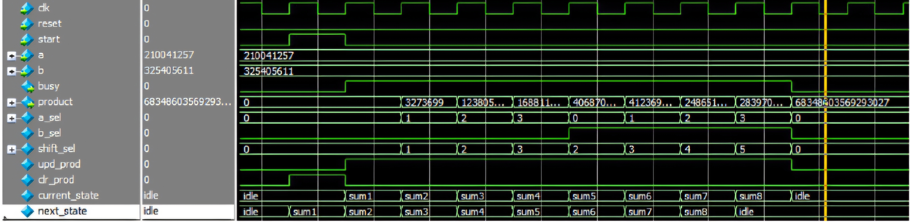
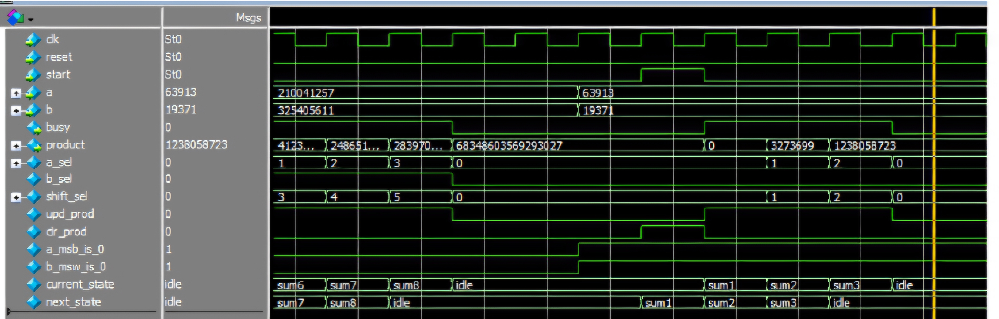

# 32x32-bit Multicycle Hardware Multiplier & Dynamic FSM Optimization

## Overview
This repository contains a SystemVerilog implementation of a 32x32-bit sequential hardware multiplier and its RISC-V Assembly software counterpart. Rather than implementing a massive, area-intensive 32x32 combinational array, this architecture optimizes silicon area by reusing a single **16x8-bit multiplier core** across multiple clock cycles, orchestrated by a Mealy Finite State Machine (FSM).

The project explores hardware-software co-design and microarchitectural optimization through three components:
1. **Baseline Sequential Multiplier (`mult32x32`):** A 9-state Mealy FSM and datapath that compute a 64-bit product over 9 clock cycles.
2. **Zero-Skipping Fast Multiplier (`mult32x32_fast`):** An optimized architecture featuring zero-detection flags (`a_msb_is_0`, `b_msw_is_0`) that dynamically bypass redundant FSM states, reducing latency by up to **55% (down to 4 clock cycles)**.
3. **RISC-V Assembly Equivalent (`mult16x16.s`):** An ISA-level implementation executing partial-product multiplication, bit-masking, and shifting in 8 clock cycles.

---

## Hardware Architecture

### 1. Datapath & Arithmetic Unit (`mult32x32_arith.sv`)
The arithmetic unit decomposes two 32-bit unsigned operands (`a[31:0]` and `b[31:0]`) into smaller chunks and accumulates their shifted partial products into a 64-bit register:
* **Operand Multiplexers:** A 4:1 multiplexer (`a_sel[1:0]`) slices operand `a` into four 8-bit bytes (`a[7:0]`, `a[15:8]`, `a[23:16]`, `a[31:24]`). A 2:1 multiplexer (`b_sel`) slices operand `b` into two 16-bit words (`b[15:0]`, `b[31:16]`).
* **16x8 Multiplier Core:** Multiplies the selected 8-bit byte of `a` with the 16-bit word of `b` to produce a 24-bit partial product (`multi_sum[23:0]`).
* **Multiplexed Barrel Shifter:** Zero-extends the 24-bit partial product to 64 bits and shifts it left by `0`, `8`, `16`, `24`, `32`, or `40` bits according to `shift_sel[2:0]`, aligning the partial product to its binary weight:

$$P = \sum_{j=0}^{1} \sum_{i=0}^{3} \left( A[8i+7 : 8i] \times B[16j+15 : 16j] \right) \ll (8i + 16j)$$

* **64-bit Accumulator (`product_register_out`):** A 64-bit adder sums the shifted partial product with the current value in the synchronous product register. Priority synchronous clearing (`clr_prod`) resets the accumulator on the rising edge of `start`, while `upd_prod` latches new sums on each active state. Because `clr_prod` is asserted combinationally (Mealy output) in the `idle` state only when `start == 1`, the multiplier preserves its 64-bit output indefinitely after completion and supports back-to-back multiplications without requiring an external `reset`.



### 2. Baseline Control FSM (`mult32x32_fsm.sv`)
The controller sequences through 8 accumulation states (`sum1` through `sum8`) after leaving `idle`:

| State | `a_sel` (Byte of A) | `b_sel` (Word of B) | `shift_sel` (Left Shift) | Partial Product Weight |
| :--- | :--- | :--- | :--- | :--- |
| `sum1` | `2'd0` (`a[7:0]`) | `1'b0` (`b[15:0]`) | `3'd0` (`<< 0`) | $2^0$ |
| `sum2` | `2'd1` (`a[15:8]`) | `1'b0` (`b[15:0]`) | `3'd1` (`<< 8`) | $2^8$ |
| `sum3` | `2'd2` (`a[23:16]`) | `1'b0` (`b[15:0]`) | `3'd2` (`<< 16`) | $2^{16}$ |
| `sum4` | `2'd3` (`a[31:24]`) | `1'b0` (`b[15:0]`) | `3'd3` (`<< 24`) | $2^{24}$ |
| `sum5` | `2'd0` (`a[7:0]`) | `1'b1` (`b[31:16]`) | `3'd2` (`<< 16`) | $2^{16}$ |
| `sum6` | `2'd1` (`a[15:8]`) | `1'b1` (`b[31:16]`) | `3'd3` (`<< 24`) | $2^{24}$ |
| `sum7` | `2'd2` (`a[23:16]`) | `1'b1` (`b[31:16]`) | `3'd4` (`<< 32`) | $2^{32}$ |
| `sum8` | `2'd3` (`a[31:24]`) | `1'b1` (`b[31:16]`) | `3'd5` (`<< 40`) | $2^{40}$ |

---

## Fast Multiplier Optimization (`mult32x32_fast`)

When upper bytes or words of the operands are zero, multiplying them yields zero and wastes clock cycles. To optimize latency:

1. **Zero-Detection Hardware (`mult32x32_fast_arith.sv`):** Added combinational comparators generating two status flags:
   * `a_msb_is_0`: Asserted (`1'b1`) when `a[31:24] == 8'd0`.
   * `b_msw_is_0`: Asserted (`1'b1`) when `b[31:16] == 16'd0`.
2. **Dynamic State Skipping (`mult32x32_fast_fsm.sv`):** The FSM inspects these flags during `sum3`, `sum4`, and `sum7` to bypass redundant states:

| `a_msb_is_0` | `b_msw_is_0` | Active State Sequence | Skipped States | Total Cycles (incl. `idle`) |
| :---: | :---: | :--- | :--- | :---: |
| `0` | `0` | `idle -> sum1 -> sum2 -> sum3 -> sum4 -> sum5 -> sum6 -> sum7 -> sum8 -> idle` | None | **9 Cycles** |
| `1` | `0` | `idle -> sum1 -> sum2 -> sum3 -> sum5 -> sum6 -> sum7 -> idle` | `sum4`, `sum8` | **7 Cycles** |
| `0` | `1` | `idle -> sum1 -> sum2 -> sum3 -> sum4 -> idle` | `sum5` – `sum8` | **5 Cycles** |
| `1` | `1` | `idle -> sum1 -> sum2 -> sum3 -> idle` | `sum4` – `sum8` | **4 Cycles** |



---

## RISC-V Assembly Implementation (`mult16x16.s`)

To demonstrate the same hardware-constrained decomposition in software, `mult16x16.s` multiplies two 16-bit operands (`a = 0x0BAD`, `b = 0xFEED`) using only a 16x8-bit multiplication primitive (simulated by masking `mul` outputs with a 24-bit mask `t0 = 0x00FFFFFF`):
1. Extracts the upper 8 bits of `a` (`srli a1, t3, 8`), multiplies by `b`, masks to 24 bits, and shifts left by 8 (`slli t6, t6, 8`).
2. Extracts the lower 8 bits of `a` (`andi a1, t3, 0xFF`), multiplies by `b`, masks to 24 bits, and accumulates into `t6`.
3. Completes the entire multiplication in exactly **8 assembly instructions (8 clock cycles at 1 CPI)**, generalized to $O(N^2)$ time complexity for arbitrary $8N$-bit operands.

---

## Repository Structure

| File | Description |
| :--- | :--- |
| `mult32x32_fast.sv` | Top-level wrapper for the zero-skipping Fast Multiplier. |
| `mult32x32_fast_arith.sv` | Fast datapath with 64-bit accumulator and zero-detection comparators. |
| `mult32x32_fast_fsm.sv` | Optimized Mealy FSM with conditional state-skipping transitions. |
| `mult32x32_fast_test.sv` | Testbench verifying both full 32-bit operands (9 cycles) and upper-zeroed operands (4 cycles). |
| `mult32x32.sv` | Top-level wrapper for the baseline 32x32 Multiplier. |
| `mult32x32_arith.sv` | Baseline datapath (4:1 & 2:1 muxes, 16x8 multiplier, barrel shifter, 64-bit adder/register). |
| `mult32x32_fsm.sv` | Baseline 9-state Mealy FSM controller. |
| `mult32x32_test.sv` | Testbench for the baseline 32x32 Multiplier. |
| `mult16x16.s` | RISC-V Assembly implementation of 16x16 multiplication using 16x8 operations. |

---

## Verification & Simulation

The hardware modules were simulated in **ModelSim** (`mult32x32_fast_test.sv`):
* **Test Case 1 (Full 32-bit Operands):** Multiplies `a = 210,041,257` by `b = 325,405,611`. Both zero flags remain `0`, and the FSM sequences through all 8 accumulation states (`sum1`–`sum8`), outputting the exact 64-bit product `68,348,603,569,293,027` in **9 clock cycles**.
* **Test Case 2 (Zero-Optimized Operands):** Multiplies `a = 0x0000F9A9` (`63,913`) by `b = 0x00004BAB` (`19,371`). Both `a_msb_is_0` and `b_msw_is_0` assert (`1'b1`), causing the FSM to transition directly from `sum3` to `idle` and outputting `1,238,058,723` in **4 clock cycles**.

### Full 9-Cycle Execution Waveform


### Optimized 4-Cycle Execution Waveform


### Running the Simulation in ModelSim
```tcl
vlib work
vlog *.sv
vsim mult32x32_fast_test
add wave -r /*
run -all

